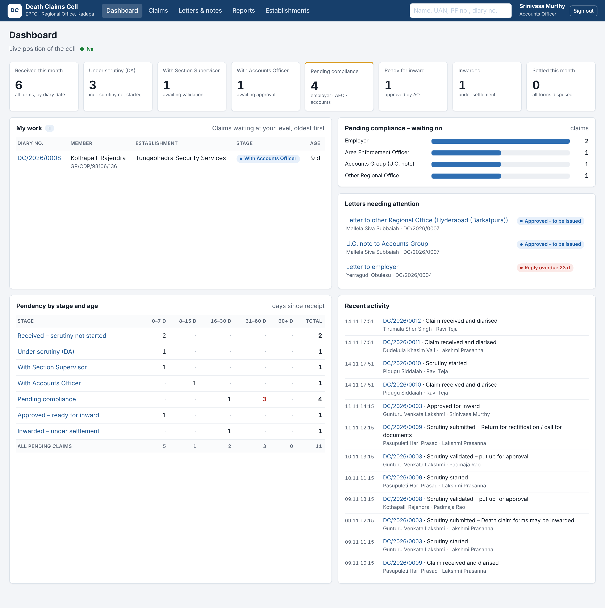
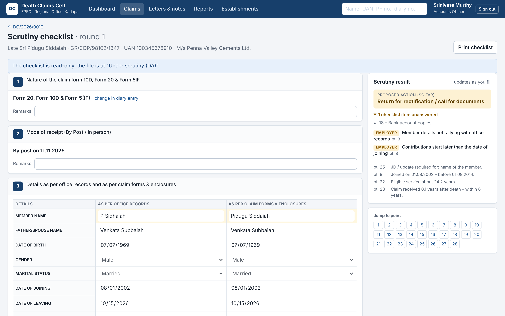
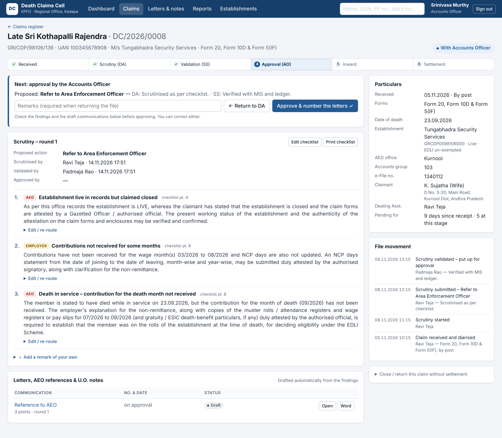
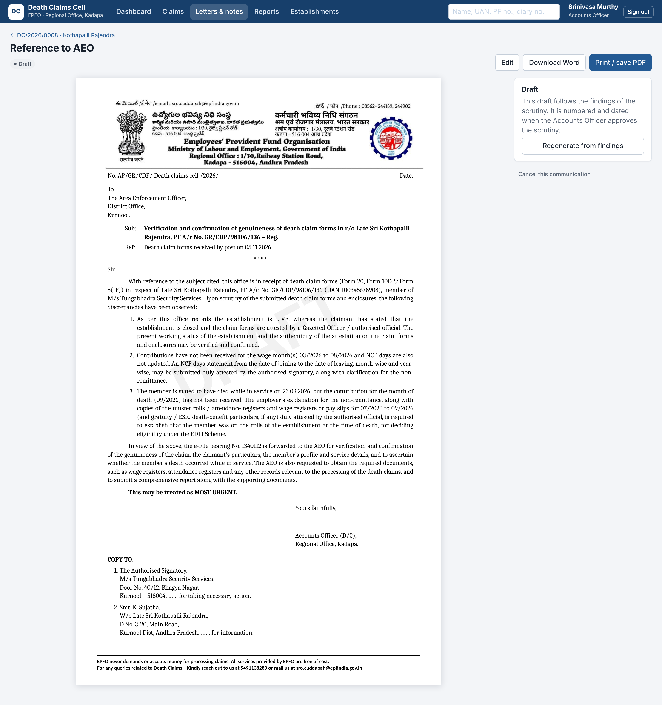
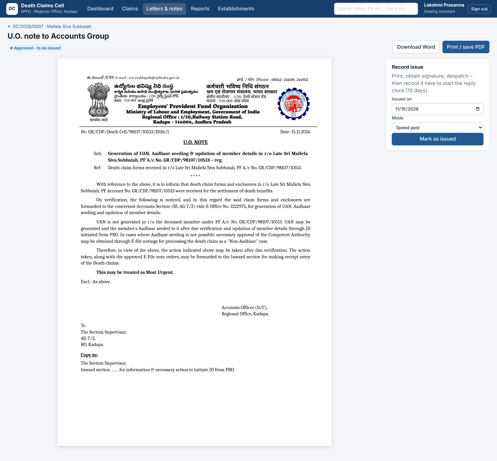
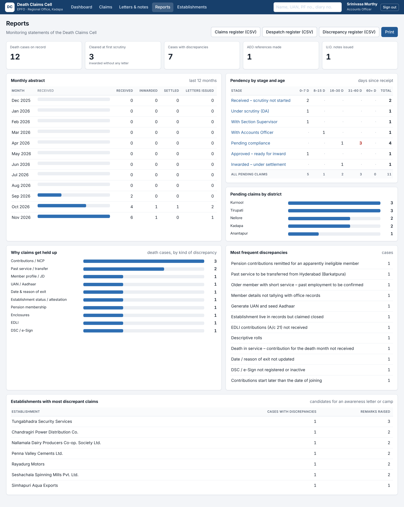

# Death Claims Cell – monitoring & automation platform

A web application for the Death Claims Cell of an EPFO Regional Office (built for
RO Kadapa). It takes a death case from **receipt → checklist scrutiny → validation →
approval → letters / AEO reference / U.O. notes → compliance → inward → settlement**,
and keeps a register, a despatch register and monitoring reports as a by-product.

The scrutiny is the heart of it: the Dealing Assistant fills the 28-point Death
Claims Checklist on screen, and the system works out the discrepancies, proposes the
disposal and drafts the communications on the office letterhead.

## Quick start

Needs Python 3.11 or later. Nothing else – the database is a single SQLite file and
the pages use no internet resources, so it runs on an office LAN.

```bash
python -m venv .venv
.venv\Scripts\activate            # Windows   (Linux/macOS: source .venv/bin/activate)
pip install -r requirements.txt
python manage.py migrate
python manage.py seed_demo        # AEO offices, demo users and 12 fictional cases
python manage.py runserver 0.0.0.0:8000
```

Open <http://localhost:8000>. Demo logins (password `kadapa@123`):

| User    | Role               | Does                                              |
|---------|--------------------|---------------------------------------------------|
| `da1`, `da2` | Dealing Assistant | registers claims, scrutinises, issues letters, inwards |
| `ss1`   | Section Supervisor | validates the scrutiny, or returns it             |
| `ao1`   | Accounts Officer   | approves (letters get numbered), or returns it    |
| `nodal` | Nodal Officer      | everything, plus `/admin/` for users and masters  |

For a real start with an empty register use `python manage.py seed_demo --masters`
(only AEO offices and the demo users), then create the real users in `/admin/`.

Run the tests with `python manage.py test`.

## How a claim moves

```
Received ─► Scrutiny (DA) ─► Validation (SS) ─► Approval (AO) ─┬─► Ready for inward ─► Inwarded ─► Settled
                 ▲                │                  │         │
                 └──── returned with remarks ────────┘         └─► Pending compliance
                 ▲                                                   │  letters issued, replies recorded,
                 └──────────── re-scrutiny (next round) ◄────────────┘  reminders, findings marked complied
```

1. **Register** – diary entry on receipt (post / in person). Diary number is automatic.
2. **Scrutiny** – the checklist screen. As it is filled, the panel on the right shows
   the discrepancies found, what is still unanswered, and the proposed action.
3. **Review** – on the claim page the DA can reword, re-route or drop any remark, or add
   one by hand. The draft communications follow the remarks automatically.
4. **Submit → validate → approve.** SS and AO can correct remarks and drafts, or return
   the file with a reason. On approval the communications get the next running number
   (`AP/GR/CDP/ Death claims cell /2026/…`) and date. If the Accounts Officer corrects
   a number by hand, later numbers follow on from it.
5. **Issue** – print on the letterhead (or download Word), despatch, record the date.
   A reply is due in 15 days; overdue letters show on the dashboard and a **reminder**
   can be drafted in one click.
6. **Compliance** – record the reply, mark remarks complied, then **re-scrutinise**: a
   new round opens with the earlier answers, and only what has changed needs updating.
   If only office-side actions were pending (U.O. note, Form-13, JD inward) the claim
   goes straight to inward once they are marked done.
7. **Inward and settlement** – claim IDs, dates, amounts and PPO number per form.

Every step is recorded in the file-movement trail with user and time.

## What the scrutiny engine checks

Each rule lives in `claims/rules.py`, has a stable code, and is covered by a test in
`claims/tests/test_rules.py`.

| Checklist | Situation | Result |
|---|---|---|
| 3, 25, 26 | Name, father/spouse name, DOB, gender, marital status or DOJ differ between office records and claim forms | Employer: Joint Declaration (online, physical if portal fails). If a JD is enclosed: Death Cell task to inward and update it |
| 3 | Date / reason of exit not updated, or inconsistent with the death | Employer: update online or submit physical JD |
| 4 | Records show Live but claimant says closed | **AEO**: confirm status and the attestation |
| 4 | Live establishment, forms not attested by employer; closed establishment, not attested at all | Employer / claimant |
| 5 | Un-exempted under EDLI but A/c 21 not received | **AEO**: verify exemption, obtain clarification |
| 6 | DSC/e-Sign not registered; attestation not tallying with it | Employer |
| 7 | Past service not transferred – same office | Death Cell task: inward Form-13 |
| 7 | Past service not transferred – another office | Letter to that Regional P.F. Commissioner |
| 7 | Older first-time member (45+ at joining), short service, no past service linked | Employer: furnish previous employment details |
| 8 | Contributions begin long after DOJ; missing months; NCP not updated; abnormal wage variation; LCM not matching exit | Employer: clarification, NCP statement, wage registers |
| 8 | Contributions received after death | Employer: clarification with records |
| 8(d) | Death in service, death-month contribution **not paid** | **AEO**: genuineness of death in service (EDLI) |
| 8(d) | Death-month contribution paid late without explanation and proof | Employer |
| 9 | Joined on/after 01.09.2014, wages above ₹15,000, no earlier EPS membership, yet EPS remitted | Employer: wage register, reconfirm eligibility. Once confirmed: U.O. note to divert A/c 10 → A/c 1 |
| 9 | Eligible for EPS but 8.33% not diverted | U.O. note to divert A/c 1 → A/c 10 |
| 10 | E-nomination filed after death | Flagged invalid on the checklist |
| 11 | Columns not filled, not signed by all claimants, enclosures not attested | Employer |
| 12 | No UAN / Aadhaar not seeded | With the member's Aadhaar copy and enclosures on hand: U.O. note to the Accounts Group for UAN generation / Aadhaar seeding through JD initiated from PRO (with the "Non-Aadhaar case" clause). Without them: employer to submit JD |
| 13–21, 27 | Death certificate, FMC, Aadhaar of beneficiaries, DOB proofs, photographs, bank accounts, minors' accounts, NCP statement, descriptive rolls | Employer (copy to claimant) |
| 22, 23 | Died away from service, under 10 years' service, and more than 3 years after exit or un-married | Form 10D not admissible – Form 10C called for |
| 24 | Interest credited beyond 3 years from death | U.O. note to deduct the excess |
| 28 | Claim filed more than 6 years after death | **AEO**, with delay clarification |
| – | Amount received back by DD / dues realised | U.O. note to re-credit |

**Proposed action** follows from who has to act: any AEO point → *Refer to AEO*; else
any employer/claimant point → *Return for rectification*; else any office-side point →
*Hold for office action*; nothing → *May be inwarded*. The checklist cannot be
submitted while required items are unanswered, so a blank checklist never reads as
"in order".

**Which communication a remark lands in**

- Any AEO point → one reference to the AEO of the establishment's district carrying
  *all* the discrepancies, copy to employer (for necessary action) and claimant.
- Otherwise → one letter to the employer, copy to claimant and AEO. If the
  establishment is closed it is addressed to the claimant.
- Accounts Group points → one U.O. note in the cell's format: numbered
  `GR/CDP/Death Cell/<estt>/<member>/<year>/<serial>`, addressed (at the foot) to the
  Section Supervisor of the claim's Accounts Group, copy to the Inward section.
- Past service elsewhere → one letter per Regional Office.

The rules only *propose*. The DA, SS and AO can reword, re-route or drop anything; an
edited remark or letter is never overwritten when the checklist is re-evaluated.

## Changing things

| To change | Edit |
|---|---|
| Office name, letter number prefix, signatory, helpline footer, reply period, age and delay thresholds | `OFFICE` in `deathcell/settings.py` |
| Serial from which letter / U.O. note numbers start, to continue the despatch register | `letter_serial_start`, `uo_serial_start` in `OFFICE` |
| Checklist points, options, wording | `claims/checklist.py` |
| A rule or the wording of a remark | `claims/rules.py` (+ its test) |
| Opening / closing paragraphs, subject lines, copy-to | `claims/letters.py` |
| Letterhead image | `claims/static/claims/letterhead.jpg` |
| Users, AEO office addresses, establishments | `/admin/` and the Establishments screen |

## Running it for the office

```bash
set DEATHCELL_DEBUG=0
set DEATHCELL_SECRET_KEY=<a long random string>
set DEATHCELL_ALLOWED_HOSTS=<server name or IP>
waitress-serve --listen=0.0.0.0:8000 deathcell.wsgi:application
```

- Change the demo passwords (or delete the demo users) before real use.
- The data is the file `db.sqlite3` – back it up daily. For many concurrent users
  switch `DATABASES` to PostgreSQL; nothing else changes.
- The application holds personal data of deceased members and their families. Keep it
  on the office network, behind logins, and do not expose it to the internet. Aadhaar
  numbers are deliberately not stored – only whether Aadhaar is seeded.

## What it does not do (yet)

- It is not connected to the EPFO application software / MIS: office-record details
  are keyed in by the Dealing Assistant from MIS and the member ledger.
- It does not read the scanned claim forms; the DA records what is in them.
- Letters are printed or exported to Word for signature and despatch; it does not send
  e-mail or push to e-Office.
- Benefit amounts are recorded at settlement, not computed.

## Layout

```
deathcell/            project settings and URLs
claims/
  models.py           Claim, Scrutiny, Finding, Communication, ClaimForm, Event
  checklist.py        the 28-point checklist as data
  rules.py            scrutiny rules engine
  letters.py          drafting of letters, AEO references, U.O. notes, reminders
  docx_export.py      Word export on the letterhead
  workflow.py         DA → SS → AO movement, permissions, audit trail
  views.py, urls.py, forms.py, templates/, static/
  management/commands/seed_demo.py
  tests/
```

## Screens

Taken with the fictional demo data (`docs/screenshots/`):

| | |
|---|---|
|  |  |
|  |  |
|  |  |
